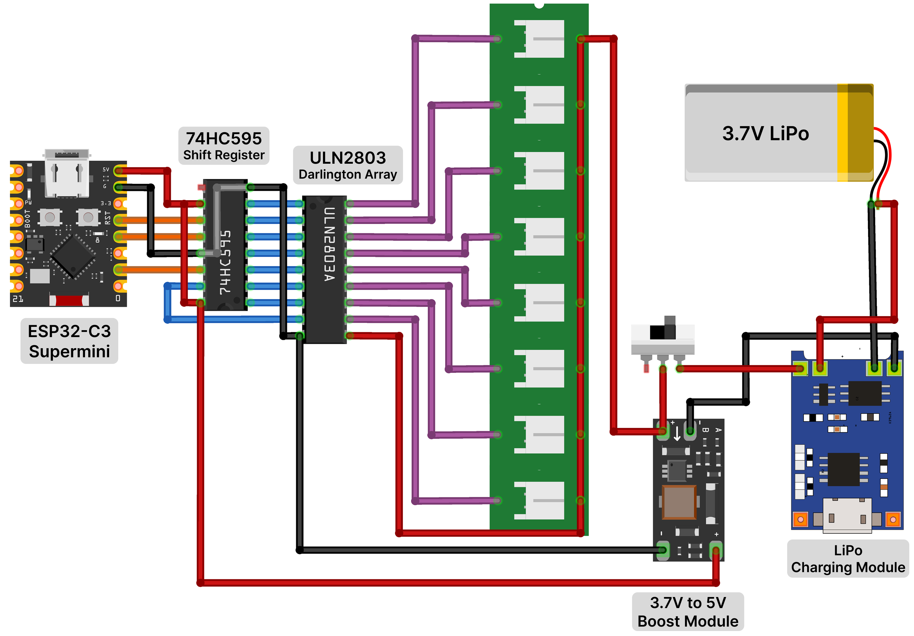
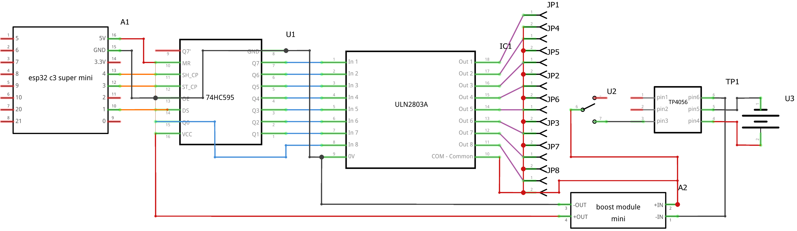
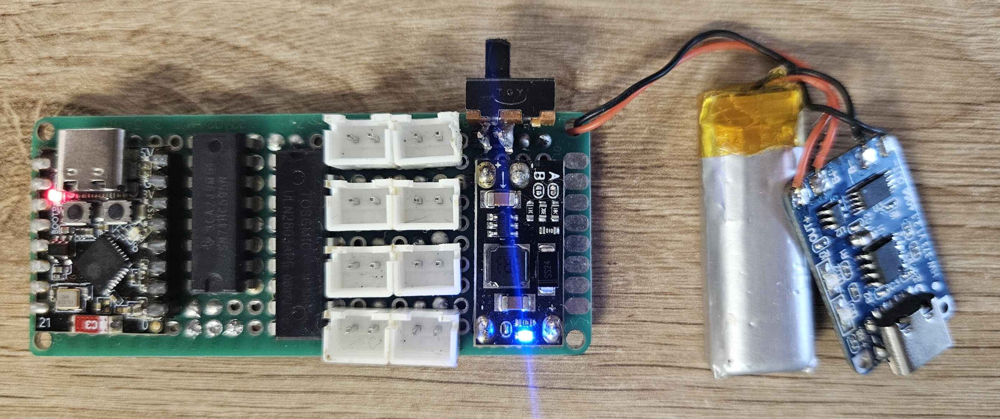
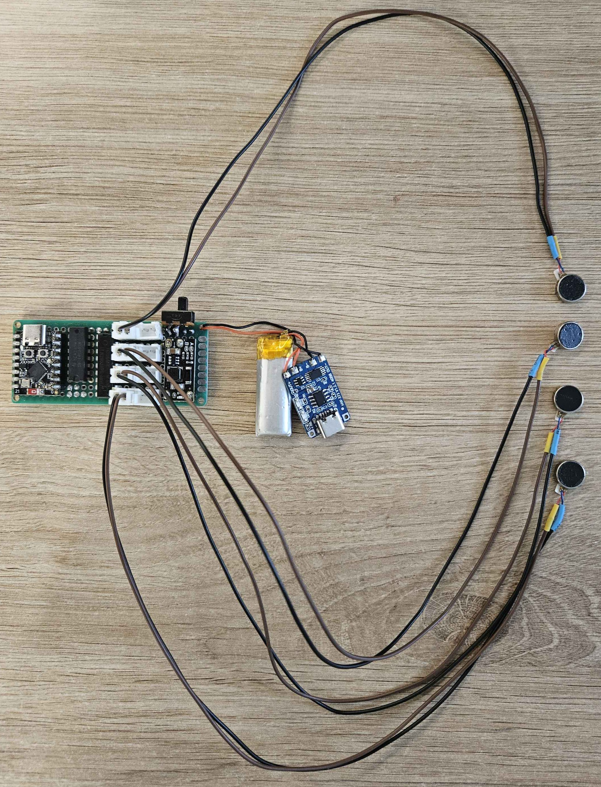

# Haptic Wearable - Building a Sixth Sense You Can Wear

> A wearable haptic device that talks to you in *touch*, not sound or visuals - quietly, in the background, without ever asking for your attention.

*Envisioned and funded by [Amit Upadhyay](https://www.linkedin.com/in/amitu/) · designed and built by me, Raaghav · at the Scaler hardware lab.*

---

## The story

This one didn't start with me. It started with a conversation.

Amit Upadhyay came to me with an idea and a job. We're all drowning in screens - every alert is a sound in a quiet room, a light in a dark one, a wrist buzz everyone at the table can hear. He wanted the opposite of that: a wearable patch you'd barely notice, that could pass you a message through nothing but a pattern of vibration. No screen to glance at, no sound to break a meeting, no tell that anyone else could see. Just *you*, quietly knowing - in a meeting, in deep work, mid-conversation, anywhere.

He backed it the whole way: funding all the components, I worked through prototyping. The build itself happened at **Scaler's hardware lab** - the bench, the soldering iron, the scope, and a room full of people who'd drift over to see what was buzzing on my desk and leave me a better idea than I started with. My job was to take Mr. Amit's vision and make it real enough to actually wear.

And his vision didn't stop at notifications. The longer arc is a programmable button matrix - press a sequence, send a predefined signal to *someone else* wearing a patch. From there it opens up into an ecosystem of devices that talk to each other: silent, ambient, person-to-person communication that never once asks for a screen. This prototype is step one of that.

---

## The idea

We have five senses and a phone that constantly fights all of them. Every notification is a sound, a flash, a screen demanding eye contact. The goal was the opposite: a channel that lives **underneath** awareness - something you could feel without stopping, the way you feel which direction is "down" without thinking about it.

So I built a band of 8 tiny vibration motors wrapped around the body and driven by patterns I can compose myself. North is a slow pulse on your left. A message is a soft double-tap at the wrist. A countdown is a wave sweeping around your arm. After a few days your brain stops *decoding* it and just **knows** - that's the sixth sense we were after.

---

## What it does

- Drives **8 independent vibration motors** as a spatial display you wear.
- Provides a **web app** ("Haptic OS") - a pattern composer in your browser.
- Plays back **custom sequences** (up to 64 steps) with per-step motor masks, buzz time, and gaps.
- **Live test** any motor combination instantly over a WebSocket.
- Runs for hours on a tiny LiPo, recharges over USB-C, and switches off with a physical slider.

---

## The hardware

### Circuit Diagram
MCU on the left, the haptics driver in the middle, power on the right:



### Circuit Schematic



### The brain - ESP32-C3 Super Mini

The whole show runs on an **ESP32-C3 Super Mini**. It's a RISC-V SoC with Wi-Fi built in, which is the entire trick: the device *is* the server. It joins your network, serves an HTML/JS app from flash, and opens a WebSocket so the browser and the body talk in real time with millisecond latency.

It only spends **three GPIOs** on control. That's deliberate - 8 motors from three pins.

### The trick - one 74HC595 shift register

8 outputs from three pins is the job of the **74HC595**, a SIPO shift register. The firmware bit-bangs it by hand for lower latency:

```c
void shift(uint8_t d){
  d = rev(d);
  digitalWrite(LATCH_PIN, LOW);
  for(int i=7; i>=0; i--){
    digitalWrite(CLOCK_PIN, LOW);
    digitalWrite(DATA_PIN, (d>>i)&1);
    digitalWrite(CLOCK_PIN, HIGH);
  }
  digitalWrite(LATCH_PIN, HIGH);
}
```

### The driver - ULN2803A Darlington array

An ESP32 pin can't drive a vibration motor - as the current draw, and the motor's inductive kickback would kill the GPIO. The **ULN2803A** sits between them: 8 Darlington transistors that each sink a motor to ground on command, with built-in flyback clamping tied to the battery rail. The 74HC595 says "on," the ULN2803 does the heavy lifting. The motors run straight off the LiPo for maximum power; the logic doesn't care.

8 2-pin JST connectors connect to the motors so the band is fully modular - unplug, re-place, re-route around the body.

### The power chain

A small, honest power path:

**LiPo** → **TP4056** (USB-C charge + protection) → **slider switch** → system → **boost module** (3.7 V → 5 V) → ESP32-C3 + 74HC595.

The motors use the raw battery (≈3.7-4.2 V) for a strong buzz, while the digital side gets the boosted 5 V.

| Block | Part | Role |
|---|---|---|
| MCU | ESP32-C3 Super Mini (`A1`) | Wi-Fi server + 3-wire control |
| Expander | 74HC595 (`U1`) | 3 pins → 8 outputs |
| Driver | ULN2803A (`IC1`) | Sinks 8 motors, flyback protection |
| Actuators | 8× vibration motors (`JP1`-`JP8`) | Core haptics |
| Charge | TP4056 (`TP1`) | USB-C LiPo charging |
| Boost | Multi boost module (`A2`) | 3.7 V → 5 V booster |
| Power | LiPo + slide switch | Portable, switchable |

---

## The Firmware

Three ideas keep the code small and the wearable responsive:

**1. Everything is non-blocking.** No `delay()` anywhere. A pattern is an array of `(mask, duration)` steps; `updatePattern()` checks `millis()` each loop and advances only when a step's time is up. Wi-Fi, WebSocket, and motors all keep breathing while a sequence plays.

**2. One byte state.** All 8 motors live in a single `uint8_t`. Setting them is one shift-out. After every change the device **broadcasts that byte back** to every connected browser, so the app is a live mirror of what your body is actually feeling.

**3. Fail safe, always.** Lose Wi-Fi, lose the last client, or stop a pattern, and the firmware calls `allOff()`. A wearable that gets *stuck buzzing* is worse than one that goes quiet, so quiet is the default.

### The protocol

The browser and device speak a tiny binary/text protocol over the WebSocket:

| Message | Direction | Meaning |
|---|---|---|
| `'0'`-`'7'` (text) | app → device | Momentarily tap one motor |
| `'T<n>'` (text) | app → device | Set the global buzz/tap duration |
| `'S'` (text) | app → device | Stop playback, all motors off |
| `'P' + len + (mask,durHi,durLo)…` (binary) | app → device | Load & play a sequence (≤64 steps) |
| 1 byte (binary) | device → app | Current 8-motor state, live mirror |

---

## Haptic OS

The ESP32 serves a single page. Open the device's IP and get the full control on your phone:


- **Live Setup** - select and test the 1-8 grid to feel motor combinations instantly.
- **Composer Sequence** - stack steps, each with its own motor mask, buzz time, and gap; reorder or delete on the fly.
- **Library** - save and reload your favourite haptic glyphs in browser storage.
- **Deploy** - play the whole sequence to the device with one button; status shows live online/offline.

It feels less like a config screen and more like a little instrument for composing things you *feel* instead of hear.

---

## The build

The assembled circuit: ESP32-C3, 74HC595 + ULN2803 pair, USB-C, and 8 motor headers.



And fully dressed: motors on long flexible leads, ready to be threaded around a band or sleeve.



---

## See it work

Patterns are easy to feel but hard to photograph - so here it is with LEDs attached alongside:

<video src="Media/Haptic_Wearable_Demonstration.mp4" controls width="520">
  Your browser can't play embedded video - open Media/Haptic_Wearable_Demonstration.mp4 directly.
</video>

---

## What I learned (and what's next)

The best technical decision was refusing to block. Once motors, network, and UI all ran off `millis()` instead of `delay()`, the device stopped feeling like a microcontroller and started feeling like a *responsive thing you wear*.

Where it goes from here - the path Amit and I sketched out:

- **Onboard pattern memory** so it works untethered from any browser.
- **A programmable button matrix** - press a sequence and send a predefined signal to another person wearing a patch.
- **A patch-to-patch ecosystem** - interconnected devices for silent, ambient, person-to-person communication.
- **Notification bridges** - let messages, navigation, and timers each get their own felt signature.
- **Closed-loop training** to find the patterns the body learns *fastest*.
- **Compact form factor** - a smaller custom PCB, to make it less obtrusive.
- **A companion app with smart connectivity** - a dedicated mobile app (iOS/Android) that replaces the browser interface, with BLE for direct phone pairing, Wi-Fi for range and multi-device sync, and hooks into smart home hubs, sensors, and calendar services - so the patch silently surfaces what matters, from anywhere, without a screen in sight.

---

## Acknowledgements

- **[Amit Upadhyay](https://www.linkedin.com/in/amitu/)** - for the vision, the funding, and the trust to hand it over and let me build it.
- **Scaler's hardware lab** - for the bench, the tools, and the makers around it who validated it and made the build better than it would have been alone.

---

## Project map

```
Haptic_Wearable/
├── Haptic_Wearable.ino              # ESP32-C3 firmware + embedded web app
├── Circuit/                         # Wiring diagram + schematic
└── Media/                           # Hardware photos, app UI, demo video
```

**Stack:** ESP32-C3 · Arduino/C++ · 74HC595 · ULN2803A · WebSockets · vanilla JS · LiPo/TP4056
