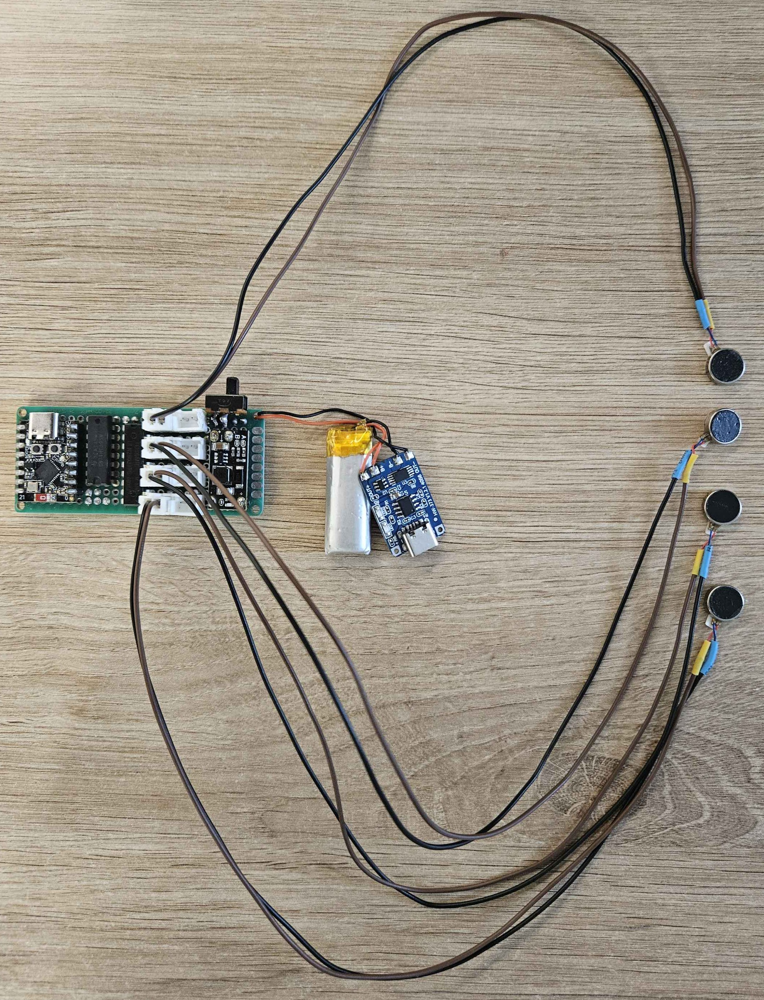

# Haptic Wearable

A wearable haptic device that acts as a silent sixth sense - it communicates through patterned vibration in the background, without interrupting what you're doing.



## Features

- 8 independent vibration motors as a wearable spatial display
- Self-hosted Wi-Fi web app - design and play patterns from any browser
- Non-blocking sequence engine, up to 64 steps (mask + buzz + gap per step)
- Live motor testing over WebSocket
- USB-C rechargeable LiPo, single power switch

## Hardware

| Block | Part |
|---|---|
| MCU | ESP32-C3 Super Mini |
| Pin expander | 74HC595 shift register |
| Motor driver | ULN2803A Darlington array |
| Actuators | 8× vibration motors |
| Power | LiPo · TP4056 · 3.7→5 V boost |

## How it works

The ESP32-C3 hosts a web app and WebSocket server. Three GPIOs drive a 74HC595, which feeds a ULN2803A that switches the eight motors. Patterns are composed in the browser and streamed to the device as a compact binary protocol.

## Quick start

1. Set `SSID` / `Password` in `Haptic_Wearable.ino`.
2. Flash to the ESP32-C3 (Arduino IDE - needs the `WebSockets` library).
3. Open the serial monitor to read the device IP.
4. Visit that IP in a browser to launch the pattern composer.

## Repository

```
Haptic_Wearable.ino            Firmware + embedded web app
Circuit/                       Wiring diagram + schematic
Media/                         Build photos, app UI, demo video
Haptic_Wearable_Devlog.md      Full project write-up
```

See [Haptic_Wearable_Devlog.md](Haptic_Wearable_Devlog.md) for the full story and design notes.
